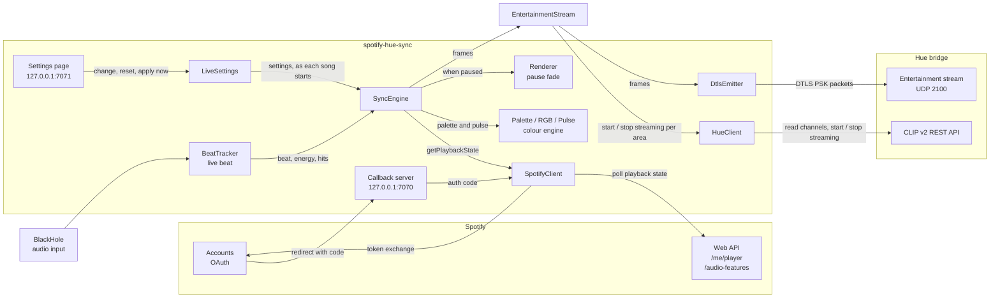
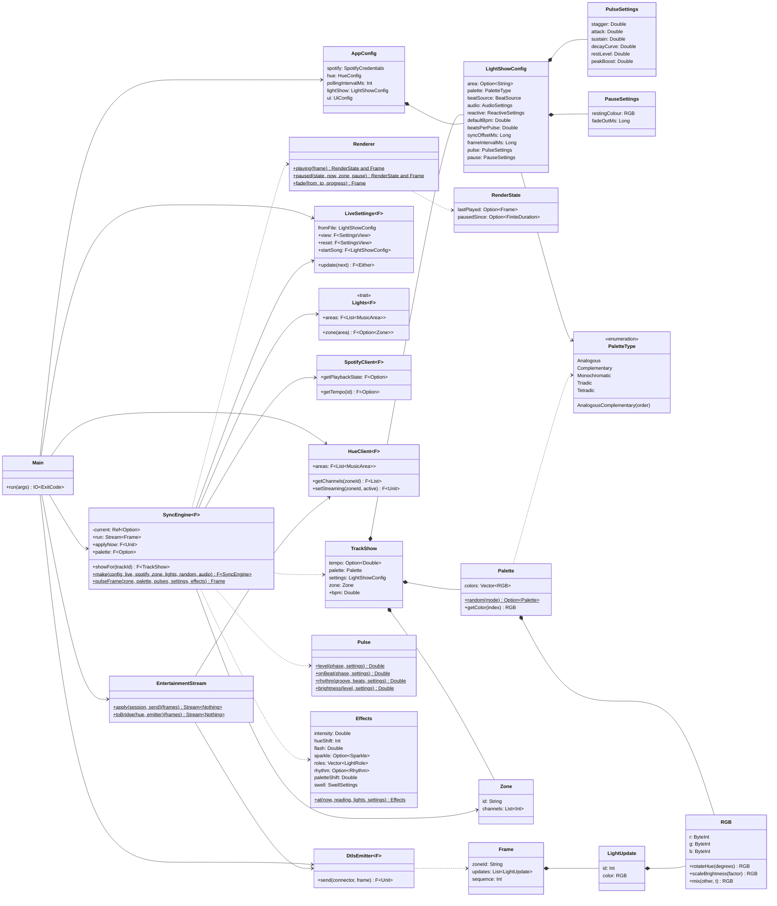
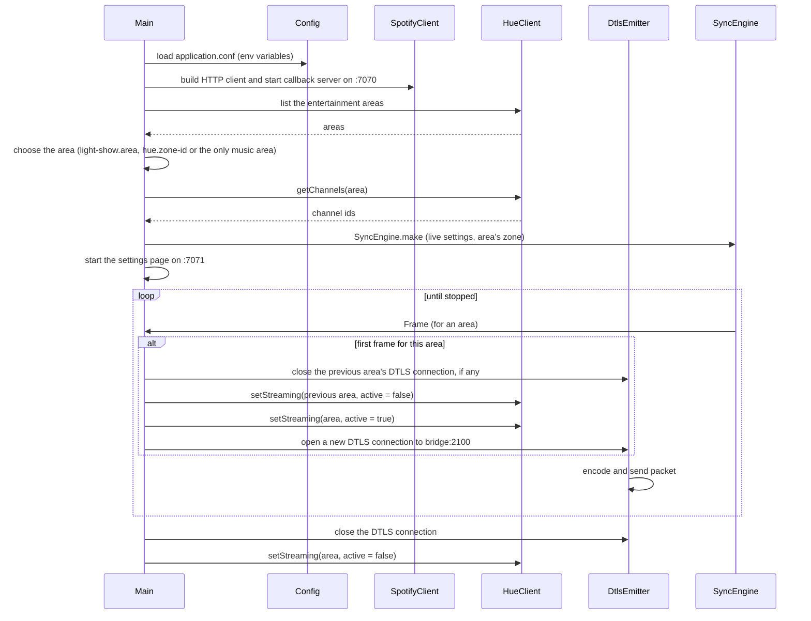

# Architecture

spotify-hue-sync is a single Cats Effect application. It polls Spotify for what is playing, turns the current track into a tempo and a colour palette, and streams a light frame to a Philips Hue entertainment zone about 60 times a second. A settings page, served by the app, changes the light show's settings for the next song.

The build has three modules:

| Module | Directory | What it is |
|---|---|---|
| `root` | `.` | The app |
| `model` | `model/` | The settings, their rules and JSON codecs, the colours (`RGB`, with plain-Scala HSB conversion) and the palette and light-role names; built for the JVM and for Scala.js |
| `ui` | `ui/` | The settings page, in Laminar, compiled to JavaScript and served by the app from `ui/main.js` beside `src/main/resources/ui/index.html` |

## Components

## Packages

| Package | What lives there |
|---|---|
| (root) | `Main`, which wires everything together, and `SyncEngine`, which turns playback state into light frames |
| (root) | Also `Lights`: the bridge's entertainment areas and the channels in each, as the engine sees them |
| `client` | Everything that talks to the outside world: `SpotifyClient`, `CachedSpotifyClient`, `HueClient` (including the list of entertainment areas), `DtlsEmitter`, and `EntertainmentStream`, which streams each frame to its area and moves the stream when the area changes |
| `audio` | `AudioInput`: captures audio from an input device such as BlackHole |
| `beat` | Live beat detection: `Fft`, `OnsetDetector`, `BeatTracker`, `BeatState`, `Groove` (the bar's kick pattern), `AudioReading` and the `BeatTracking` stream |
| `domain.config` | `AppConfig`, `HueConfig`, `UiConfig` and `LightShowConfig` (with `PulseSettings`, `PauseSettings`, `AudioSettings`, `ReactiveSettings` and `SwellSettings`, in `model`), loaded with pureconfig from `application.conf` on top of the defaults in `reference.conf` by `LightShowConfigReaders`; `SettingsView`, `SettingsProblems` and `ConfigSnippet` for the settings page |
| `settings` | `LiveSettings` (the settings for this session, taken up as each song starts), `SettingsRoutes` (the page and its API), `ShowControls` (what the page asks of the running show: apply now, the areas, the song's palette) and `SettingsServer` |
| `ui` | The settings page: `SettingsPage`, `Sections` (every setting on it), `Api` |
| `domain.engine` | The colour engine and animation: `RGB`, `Palette`, `PaletteType`, `Order`, `Pulse` (the envelopes), `Effects` (the reactions to the music), `LightRole` (each light's job), `Renderer` (the pause fade) and `LocalPlayback` |
| `domain.hue` | The Hue streaming protocol: `Zone`, `Frame`, `LightUpdate` and their binary codecs; `MusicArea` (in `model`), an entertainment area and how the one to play on is chosen |
| `domain.spotify` | Spotify API models: `PlaybackState`, `SpotifyToken`, `SpotifySession`, `SpotifySegment`, `SpotifyCredentials` |
| `givens.circe` | Shared circe codecs |

## Main types

## Startup and shutdown

`Main` builds everything as a single `Resource`, so every connection and server is closed in reverse order when the app stops.

## Effects and concurrency

- Everything runs in `IO` through tagless-final `F[_]` constraints (`Async`, `Network`).
- Shared state lives in Cats Effect primitives:
  - `Ref` for the Spotify session (access and refresh tokens), the current song's show, the pending and applied settings (`LiveSettings`), each area's channels once read (`Lights`), and the track-analysis cache
  - `Deferred` to hand the OAuth code from the callback server to the client
  - `SignallingRef` for the latest playback state shared by the poller and the renderer
- The poller and the renderer are two fs2 streams merged into one, so stopping the app cancels both.
- `Hotswap` holds the entertainment session on the current area, so moving to another area closes the old session before opening the new one, and stopping the app closes the last.
- The settings page's server is a `Resource` like the rest, so it stops with the app.
- The renderer threads its pause state through `evalMapAccumulate`, and reads time from `Clock`, so the whole engine runs on Cats Effect's simulated clock in tests (`TestControl`).
