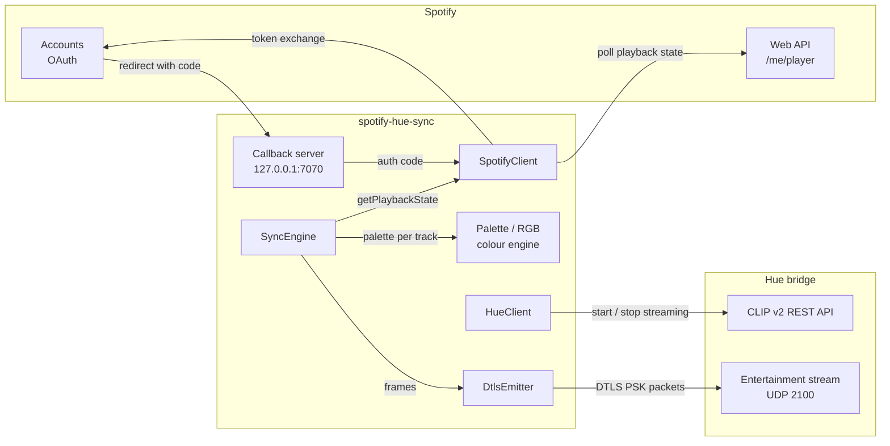
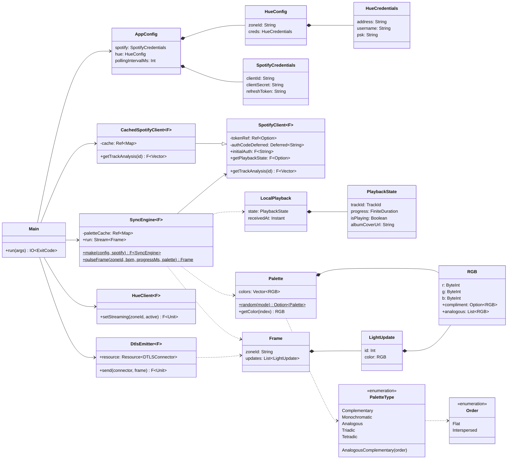
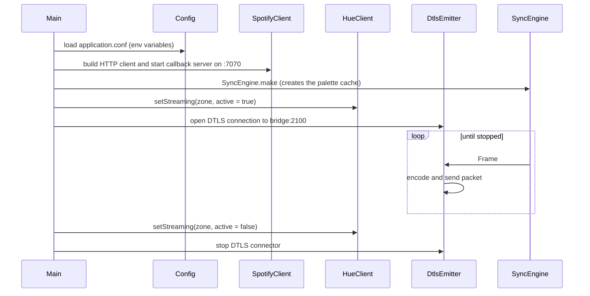

# Architecture

spotify-hue-sync is a single Cats Effect application. It polls Spotify for what is playing, turns the current track into a colour palette, and streams a light frame to a Philips Hue entertainment zone about 60 times a second.

## Components

## Packages

| Package | What lives there |
|---|---|
| (root) | `Main`, which wires everything together, and `SyncEngine`, which turns playback state into light frames |
| `client` | Everything that talks to the outside world: `SpotifyClient`, `CachedSpotifyClient`, `HueClient` and `DtlsEmitter` |
| `domain.config` | `AppConfig` and `HueConfig`, loaded from `application.conf` with pureconfig |
| `domain.engine` | The colour engine: `RGB`, `Palette`, `PaletteType`, `Order` and `LocalPlayback` |
| `domain.hue` | The Hue streaming protocol: `Frame`, `LightUpdate` and their binary codecs |
| `domain.spotify` | Spotify API models: `PlaybackState`, `SpotifyToken`, `SpotifySegment`, `SpotifyCredentials` |
| `givens.circe` | Shared circe codecs |

## Main types

## Startup and shutdown

`Main` builds everything as a single `Resource`, so every connection and server is closed in reverse order when the app stops.

## Effects and concurrency

- Everything runs in `IO` through tagless-final `F[_]` constraints (`Async`, `Network`).
- Shared state lives in Cats Effect primitives:
  - `Ref` for the Spotify access token, the palette cache and the track-analysis cache
  - `Deferred` to hand the OAuth code from the callback server to the client
  - `SignallingRef` for the latest playback state shared by the poller and the renderer
- The poller and the renderer are two fs2 streams merged into one, so stopping the app cancels both.
