# How it works

This page follows a frame from Spotify to your lights: authentication, the two loops that drive the app, the colour engine, the pulse animation, what happens on pause, and the Hue streaming protocol. Every tuning value mentioned here can be changed in config; see [Configuration](#7-configuration).

## 1. Signing in to Spotify

The app uses Spotify's authorization code flow.

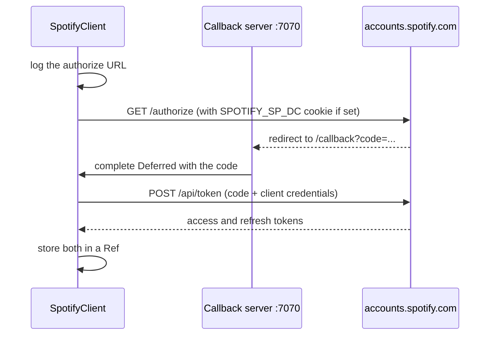

- The first call to Spotify triggers the sign-in. The app logs the authorize URL; opening it in a browser completes the flow.
- If `SPOTIFY_SP_DC` is set, the app also requests the authorize URL with that session cookie, which can complete the consent step without a browser.
- The callback server listens only on `127.0.0.1:7070`, so it is not reachable from other machines.
- Access tokens expire after about an hour. When Spotify rejects one, the app swaps the refresh token for a new access token (`POST /api/token` with `grant_type=refresh_token`) and sends the request again. If that fails, the poll fails with an error in the log rather than being read as "nothing playing".

## 2. Two loops: polling and rendering

`SyncEngine.run` merges two fs2 streams that share the latest playback state through a `SignallingRef`.

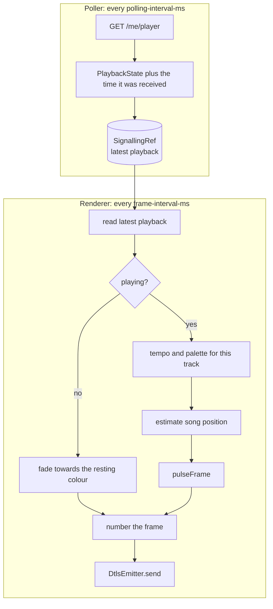

- **Poller.** Asks Spotify what is playing every `polling-interval-ms` (1000 ms in the shipped config). Failed polls are logged and treated as "nothing playing", so a network blip doesn't stop the app.
- **Renderer.** Runs every `frame-interval-ms` (16 ms, about 60 times a second). Spotify only reports the song position once per poll, so the renderer estimates where the song is now:

  `position = progress_ms + (now - time the poll arrived) + sync-offset-ms`

  `sync-offset-ms` (−150 ms by default) nudges the lights to line up with the audio.
- The renderer always sends a frame, playing or not, and numbers each one (see [Streaming to Hue](#6-streaming-to-hue)).

## 3. The colour engine

### Colours

`RGB` holds three channels, each a refined `Int` between 0 and 255, so an invalid colour can't be constructed through `RGB.safe`. Colour operations convert to HSB (hue, saturation, brightness), where the colour wheel lives, and back to RGB.

### Colour theory

| Relationship | How it's computed | Result |
|---|---|---|
| **Analogous** | Rotate the hue 30° each way, keeping saturation and brightness | `[base - 30°, base, base + 30°]`: neighbours on the wheel |
| **Complementary** | Invert each RGB channel (`255 - value`) | The colour opposite on the wheel (hue + 180°). Brightness and saturation change too, so a dark colour's complement is light |
| **Triadic** | Rotate the hue by 120° and 240° | Three colours evenly spaced around the wheel |
| **Tetradic** | Rotate the hue by 90°, 180° and 270° | A square: four colours evenly spaced around the wheel |
| **Monochromatic** | Keep the hue and saturation, set brightness to 35%, 65% and 100% | Shades of a single hue |

Each relationship is checked by property tests, for example that triadic hues are 120° apart and that monochromatic shades share one hue.

On the colour wheel, an **analogous** palette is a tight cluster of neighbours, which gives a calm, cohesive look:

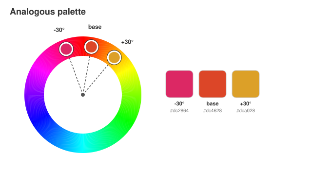

A **complementary** palette sits on opposite sides of the wheel, which gives the strongest contrast:

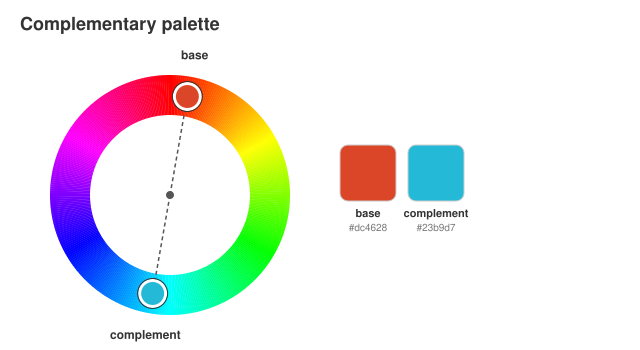

**Triadic** and **tetradic** palettes spread evenly around the wheel, which gives a vivid, varied look:

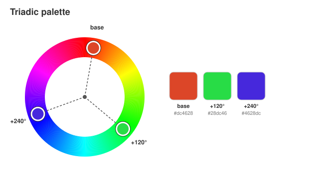

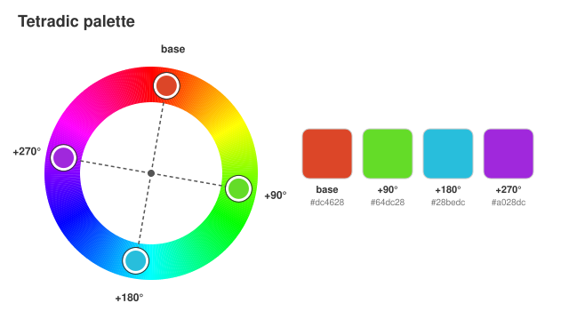

A **monochromatic** palette stays on one spoke of the wheel and varies only in brightness, which gives a subtle, moody look:

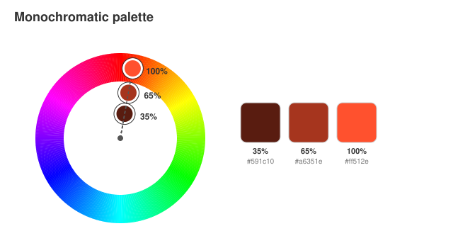

### Palettes

`Palette.random(mode)` picks a random base colour and builds a palette from it. Choose the type with `light-show.palette`:

| `light-show.palette` | `PaletteType` | Colours |
|---|---|---|
| `analogous` (default) | `Analogous` | `[base - 30°, base, base + 30°]` |
| `complementary` | `Complementary` | `[base, complement]` |
| `triadic` | `Triadic` | `[base, base + 120°, base + 240°]` |
| `tetradic` | `Tetradic` | `[base, base + 90°, base + 180°, base + 270°]` |
| `monochromatic` | `Monochromatic` | the base hue at 35%, 65% and 100% brightness |
| `analogous-complementary` | `AnalogousComplementary(Flat)` | the base triad, then the complement's triad |
| `analogous-complementary-interspersed` | `AnalogousComplementary(Interspersed)` | the two triads interleaved |

**Analogous-complementary** combines two of them: the base triad on one side of the wheel and the complement's triad opposite it. `Order` only changes the sequence, and so which lights get which colour:

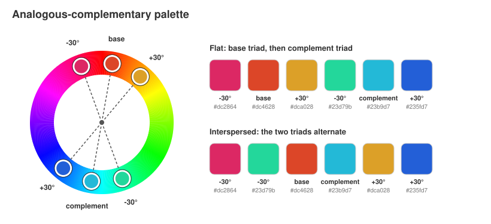

A palette is generated the first time a track is seen and cached in a `Ref` for the rest of that track, so the colours stay stable while a song plays.

### Assigning colours to lights

At startup the app asks the bridge which channels the entertainment zone has (`GET /clip/v2/resource/entertainment_configuration/{zone}`), so it drives exactly the lights in your zone, sorted by channel ID.

`getColor(index)` is a 0-based circular index: the first light gets the first colour, and the palette repeats after the last one. With a three-colour palette `[c1, c2, c3]` and seven lights:

| Light | 0 | 1 | 2 | 3 | 4 | 5 | 6 |
|---|---|---|---|---|---|---|---|
| Colour | c1 | c2 | c3 | c1 | c2 | c3 | c1 |

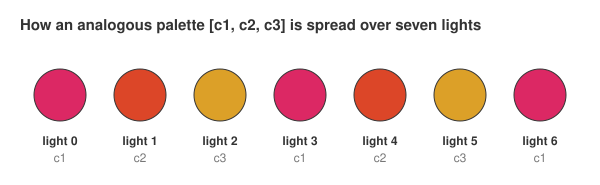

## 4. The pulse

### Timing: live beat or Spotify

With `beat-source = "audio"`, the pulses follow the beat detected live from your audio (see [Live beat detection](#live-beat-detection)). While the tracker hasn't locked on, or with `beat-source = "spotify"`, they follow Spotify's playback position at the track's tempo, as described next.

### Tempo from Spotify

When a new track starts, the app asks Spotify for its tempo (`GET /v1/audio-features/{id}`) and pulses in time with it. Spotify restricted this endpoint for newer apps in late 2024; if it refuses, or the request fails, the app uses `default-bpm` (20 BPM, one pulse every 3 seconds) instead. The tempo is fetched once per track and cached.

`beats-per-pulse` slows fast tracks down: `2` pulses on every other beat, so a 128 BPM track pulses at 64 BPM.

### Live beat detection

Spotify's tempo isn't enough to land on the beat: it says how fast, not where the beats fall, and it isn't available to newer apps. So the app can listen to the music itself, through a virtual audio device such as [BlackHole](https://github.com/ExistentialAudio/BlackHole).

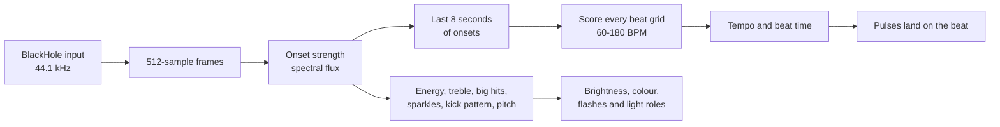

1. **Capture.** `AudioInput` reads 16-bit stereo audio from the input named in `audio.device` and mixes it to mono, 512 samples (about 12 ms) at a time. `CaptureClock` times each block by how many samples have arrived, anchored to the promptest read of the last 10 seconds, rather than by when the read returned: reads come back in bursts, and stamping audio that had been waiting with the time it was read made beats look up to 30 ms later than they were.
2. **Onsets.** For each frame, `OnsetDetector` takes a 1024-sample FFT and measures how much louder each frequency got since the last frame (spectral flux). Kicks and note attacks make it spike. Frequencies below about 300 Hz count most, because the kick and bass usually carry the beat while hi-hats fill in between.
3. **Tempo and phase.** Four times a second, `BeatTracker` tries every beat grid between `min-bpm` and `max-bpm` against the last 8 seconds of onsets, and keeps the grid whose beats land on the strongest onsets. Grids that skip beats are penalised, and tempos far from 120 BPM are slightly less likely, which settles most double-or-half ambiguities. The winning grid gives the tempo. Where its beats fall is then chosen from the low end alone (below about 300 Hz): the kick lands on the beat, while hi-hats usually land between beats and can outweigh it, which would put every pulse on the off-beat. Once locked, the tracker follows its own grid, allowing for a little drift, and only moves to another phase when that has been stronger for several seconds, so a few bars of off-beat bass don't throw the lights half a beat out.
4. **Pulsing.** Each frame, the engine works out how many beats have passed since that beat, shifted by `audio.offset-ms` to make up for capture and bridge latency, and divides by `beats-per-pulse`.

Each estimate comes with a confidence: how far the grid's beats stand above the average onset, in standard deviations. The tracker locks on to an estimate with a confidence of 2.5, or to 3 seconds of estimates that agree on the tempo with a typical confidence of 1.2 or more, because a tempo that stays put is evidence in itself: real songs often score well under 2.5 while the tempo doesn't budge. Once locked, a weaker estimate (1.2 or more) keeps the beat as long as it agrees on the tempo. When no estimate qualifies, the tracker keeps the last beat for up to `audio.hold-seconds` (10 seconds), so a breakdown, a quiet bridge or the gap between songs doesn't knock the lights off the beat. After that the show falls back to Spotify timing until the tracker locks on again. If the audio device can't be opened, the app logs why and carries on with Spotify timing.

The app logs when the tracker locks on, when it loses the beat, and when the tempo moves by more than 3% from the last tempo logged, with the confidence of each estimate, which helps when tuning.

The tracker is tested against generated drum patterns: it finds the exact tempo between 90 and 150 BPM, finds the tempo or exactly double or half of it between 72 and 170 BPM, and lines its beats up with the real ones to within 30 ms. It also handles a change of tempo, puts the beat on the kick even when off-beat hi-hats are louder, holds its phase through a few bars where the off-beat is stronger and follows a lasting move to the other phase, holds the beat through silence and through a passage with no drums, and lets go once the hold runs out. Drums buried under noise score too low to lock onto straight away, but it locks on once their tempo has held for a few seconds. It runs about 100 times faster than real time.

#### Setting up BlackHole on macOS

1. Install it: `brew install blackhole-2ch` (it asks for your password).
2. Open **Audio MIDI Setup**, click **+**, choose **Create Multi-Output Device**, and tick both your speakers (or headphones) and **BlackHole 2ch**. This lets you hear the music while the app listens to it.
3. Choose that Multi-Output Device as your Mac's sound output.
4. Set `light-show.beat-source = "audio"`. The first time the app listens, macOS may ask for microphone access for your terminal: allow it, or the app only hears silence.

### Shape

Each pulse has three phases, set by `pulse.attack`, `pulse.sustain` and `pulse.decay-curve`:

| Part of the pulse | Phase | Brightness curve |
|---|---|---|
| 0% to 20% | attack | rises linearly from 0 to 1 |
| 20% to 30% | sustain | holds at 1 |
| 30% to 100% | decay | falls as `(1 - x)²`, a soft fade that lingers |

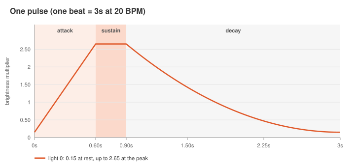

The pulse is timed so the attack ends on the beat (`Pulse.onBeat`): a light rises during the last fifth of the previous beat and is at full brightness on the beat itself. Rising from the beat instead would leave the peak a fifth of a beat late, which is 100 ms at 120 BPM and more on slower songs, a delay no fixed offset can correct.

The curve value `p` becomes a brightness multiplier of `rest-level + peak-boost × p`, which is `0.15 + 2.5 × p` by default: a light glows at 15% of its colour's brightness at rest, and is boosted 2.65× at the peak.

### Keeping the colour at the peak

The brightness multiplier is applied in HSB: only the brightness is scaled (and capped at 100%), while the hue and saturation stay the same. The engine used to multiply each RGB channel instead, which capped the strongest channel at 255 while the others kept rising, so bright colours washed out towards yellow and white at every peak:

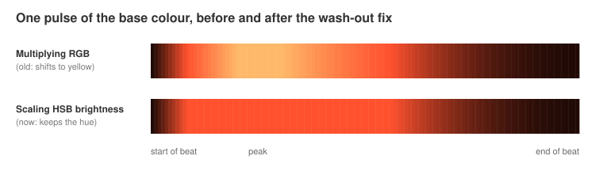

A property test checks that at the peak the hue never moves by more than 2°.

### The wave

Light 0 peaks on the beat, and each light after it peaks `pulse.stagger` (0.15) of a beat after the one before, so the pulse travels across the zone instead of flashing all lights at once. With live audio, the default [light roles](#light-roles) replace the wave with rhythm and colour lights; any light given the `pulse` role still travels with it.

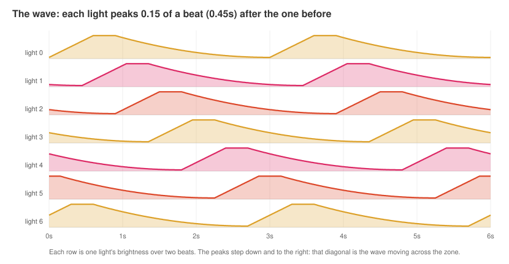

Put together, this is what the seven lights show over two beats:

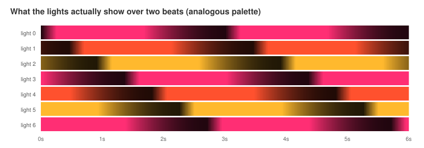

The pulse is computed by the pure functions `Pulse.level`, `Pulse.brightness` and `SyncEngine.pulseFrame`, so it's easy to test: the tests cover the envelope's shape, the stagger, the tempo, the brightness at rest and at the peak, and that every value stays between 0 and 255 for any tuning.

### Reacting to the music

With live beat detection, the lights follow more than the beat. While it listens, the tracker also measures how the music is changing, and `Effects.at` turns that into four reactions, tuned under `reactive`:

| Reaction | What the tracker hears | What the lights do |
|---|---|---|
| Energy | How loud the last second or two is, compared with the usual level over the last 20 seconds or so | Brightness scales with it, between `quietest` (0.35×) and `loudest` (1.6×), so a quiet verse glows and a chorus blazes |
| Treble | How busy the hi-hats and cymbals are, compared with usual | The palette of [pulse lights](#light-roles) turns by up to `colour-shift` (25°) one way as the treble picks up, and the other way as it drops away |
| Big hits | Loudness jumping above anything in the last 4 seconds by `hit-ratio` (1.15×), such as a crash or a drop | Every light flashes towards white by up to `flash`, fading over about `flash-decay-ms` |
| Sparkles | A treble onset well above the treble background (`sparkle-ratio`), such as a hi-hat | One light that isn't a rhythm light, scattered across the zone, twinkles towards white by `sparkle`, fading over about `sparkle-decay-ms` |

The usual level is only learnt while music plays, so a silence between songs doesn't drag it down. Nothing counts as a big hit or a sparkle until a few seconds of music have set the bar. `reactive.enabled = false` turns all four off, along with the light roles, and with Spotify timing they don't apply.

The tests use generated drums: energy rises and falls with the loudness and settles at about 1 while the level stays the same; a crash is a big hit at the moment it happens, even on top of a kick, while a steady pattern has none; and hi-hats sparkle while kicks hardly ever do. `Effects.at` and `pulseFrame` are property-tested to keep every value in range for any reading and tuning.

### Light roles

With live audio, each light has a job, set by `reactive.roles` and repeated across the zone in channel order. The default, `["rhythm", "colour"]`, alternates them, so on a zone where each room's lights have neighbouring channels, every room gets one of each.

| Role | What it follows | What it does |
|---|---|---|
| `rhythm` | The kick pattern of the bar | Pulses on the sixteenths where the kick hits, as hard as it usually hits there, all rhythm lights together. Until there's a live beat, it pulses on every beat |
| `colour` | How high the vocals, leads and chords sit, and the beat | Swells once every two beats (`colour-swell`), and moves along the palette: up to `colour-reach` colours towards the end as the music goes higher, towards the start as it goes lower |
| `pulse` | The beat | The classic pulse travelling across the zone, its palette turning with the treble |

`["pulse"]` gives the classic show on every light. Without live audio, or with `reactive.enabled = false`, every light pulses. Energy and big hits reach every light whatever its role.

**Rhythm lights play the pattern ahead of time.** Reacting to each kick as it's heard would light up after it: capture, analysis and the bridge add up to about 100 ms, which is easy to see. Instead, `Groove` learns where in the bar the kick falls, in sixteenths of a four-beat bar counted along the beat grid, and the lights play that pattern on the predicted grid, shifted by `audio.offset-ms` like the beat pulse. `BeatState.number` keeps counting beats from the moment the tracker locks on, so the pattern stays in place as the tracker re-estimates.

The kick is heard as a jump in the power between about 40 and 130 Hz. This is raw power, not the compressed onset strength the beat tracker uses: on the six songs recorded through BlackHole, the compressed low end rose about equally on every sixteenth, because dance tracks duck the bass on each kick and it swells back in between, while the raw power landed mostly on the beat. Each sixteenth's average power is learnt over about six bars, and a sixteenth lights in proportion to how far it stands above the typical sixteenth of the bar. A shorter average over the last bar or two scales the whole pattern, so when the kick drops out for a breakdown the rhythm lights fade within a few bars, and come back when it returns. Until a full bar has been heard after locking on, they pulse on every beat. The six recorded songs are four-on-the-floor dance tracks, so there the pattern is mostly a kick on every beat; music with a sparser or syncopated kick shows more of a pattern.

**Colour lights swell at half the tempo.** A swell rises slowly over 45% of its two beats, holds for 10%, then fades with the same curve as the pulse, peaking on every other beat. Its brightness runs from a quarter of the colour's own up to the colour's own, without the pulse's boost: boosted brightness is capped at full, which would flatten the top of the swell into a plateau and make the slow rise look quick. With a live beat, the swell is timed by the beat count from locking on, so it stays on the same beats as the tracker re-estimates; without one, it follows the same timing as the pulse.

**Colour lights follow the pitch.** For each frame, `OnsetDetector` finds where the sound between about 300 Hz and 4 kHz is centred, in octaves: below that range are the kick and bass, above it the hi-hats. The tracker smooths it over about 0.4 seconds and compares it with what's usual for the track over the last 20 seconds or so, giving a value from -1 (well below usual) to 1 (well above), where a typical move away from usual is about 0.4. It reflects where the music sits rather than which notes are played: a higher melody or a brighter sound both raise it.

The colour light's place along the palette blends neighbouring palette colours round the colour wheel (`RGB.turnTowards`), so the colours in between stay as vivid as the palette's own, and it stops at either end of the palette rather than wrapping round. With an analogous palette (-30°, base, +30°) and the default reach, the light whose colour is the base turns to +30° at the top and -30° at the bottom; the lights at either end of the palette move only one way.

The tests cover each part: `Groove` learns where the kicks fall wherever in the grid it starts, fades within a few bars when they stop, and stays between 0 and 1 for any input; a groove with a full kick on every beat gives exactly the beat pulse, and a kick on one sixteenth peaks on it and is dark half a bar later; on generated drums, the tracker learns a kick on every beat and on every other beat, and counts beats on without a jump through every re-estimate; a pure tone's pitch is its frequency, and pitch rises and falls as a tone moves; colour lights rest until their swell starts to rise, peak on the beat and keep their place along the palette throughout, and pulse lights are unchanged by what the other lights do.

## 5. Pause

When playback stops, or Spotify can't be reached, the lights don't freeze on the last frame. They fade from whatever they were showing to `pause.resting-colour` over `pause.fade-out-ms`, then hold that colour until music starts again. Before anything has played, the zone shows the resting colour.

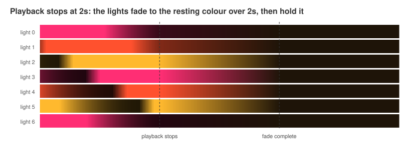

The fade is a small state machine (`Renderer`): it remembers the last frame that played and when the pause started, and blends each light towards the resting colour. Resuming playback clears the pause, so the next pause fades from the new frame. Because frames keep flowing during a pause, the bridge's stream never goes quiet.

## 6. Streaming to Hue

Hue's Entertainment API takes a stream of UDP packets secured with DTLS, instead of one REST call per light change.

1. `HueClient.getChannels` reads the zone's channel IDs from the bridge.
2. `HueClient.setStreaming` calls the bridge's CLIP v2 API (`PUT /clip/v2/resource/entertainment_configuration/{zone}`) with `{"action": "start"}`. This opens the streaming port.
3. `DtlsEmitter` opens a DTLS connection to the bridge on port 2100 using Californium Scandium. It authenticates with a pre-shared key: the identity is `HUE_USERNAME` and the key is `HUE_PSK`.
4. Each frame is encoded with scodec into this layout:

| Bytes | Field | Value |
|---|---|---|
| 9 | protocol name | `HueStream` |
| 2 | version | `02 00` |
| 1 | sequence | counts up with every frame, wrapping from 255 back to 0 |
| 2 | reserved | `00 00` |
| 1 | colour space | `00` (RGB) |
| 1 | reserved | `00` |
| 36 | entertainment configuration ID | the zone's UUID as text |
| 7 per light | channel and colour | channel ID (1 byte), then red, green and blue as 16-bit big-endian values |

A frame is 52 bytes plus 7 per channel, so 101 bytes for seven lights. The colour engine works in 8-bit colour, so each value is shifted left by 8 bits to fill the 16-bit fields.

5. When the app stops, the stream's finalizer calls `setStreaming(active = false)` and the DTLS connector is closed.

### Choosing the area

The bridge can stream to one entertainment area at a time: the music and TV areas set up in the Hue app. At startup the app lists them and plays on the one `light-show.area` names, matched ignoring case. Without a name it uses the area whose id is in `hue.zone-id`, or the bridge's only music area; if it can't tell which to use, or the name doesn't match, it stops with a message listing the areas there are.

The area is one of the light-show settings, so the settings page can change it too, and it changes when the next song starts. Each frame names its area, and `EntertainmentStream` follows them: the first frame for a new area stops the stream on the old one, whose lights go back to how they were, then starts streaming on the new one with a fresh DTLS session. Each area's channels are read from the bridge the first time it's used. If the area can't be found when the song starts, the show stays where it is and logs why.

## 7. Configuration

All light-show settings live under `light-show` in `src/main/resources/reference.conf`, with a description of each. Override any of them in `application.conf`:

```hocon
light-show {
  palette = "triadic"
  beats-per-pulse = 2
  pulse.peak-boost = 1.5
  pause.resting-colour = "#0a0a20"
}
```

| Setting | Default | What it does |
|---|---|---|
| `area` | none | The entertainment area to play on, by name, such as `"Muziekruimte Boven"`. Without one, the app uses `hue.zone-id` (`HUE_ZONE_ID`), or the bridge's only music area. See [Choosing the area](#choosing-the-area) |
| `palette` | `analogous` | Palette type (see [Palettes](#palettes)) |
| `beat-source` | `spotify` | `audio` to follow the live beat, `spotify` to follow playback position and tempo |
| `audio.device` | `BlackHole` | Audio input to listen to, matched by name |
| `audio.offset-ms` | `100` | Shifts the lights relative to the detected beat; positive is earlier |
| `audio.min-bpm`, `audio.max-bpm` | `60`, `180` | Tempo range the beat tracker searches |
| `audio.hold-seconds` | `10` | How long to keep the last confident beat when the music no longer gives a clear one |
| `reactive.enabled` | `true` | Turns the [reactions to the music](#reacting-to-the-music) on or off |
| `reactive.quietest`, `reactive.loudest` | `0.35`, `1.6` | Brightness range as the energy changes |
| `reactive.roles` | `["rhythm", "colour"]` | Each light's [role](#light-roles), repeated across the zone in channel order |
| `reactive.colour-reach` | `1.0` | How many palette colours the colour lights move at the highest or lowest pitch |
| `reactive.colour-swell.beats` | `2` | Colour lights swell once every this many beats, peaking on the beat |
| `reactive.colour-swell.attack`, `.sustain`, `.decay-curve` | `0.45`, `0.1`, `2.0` | The swell's shape, as for the pulse: a slow rise, a brief hold, then the fade |
| `reactive.colour-swell.rest-level`, `.peak-boost` | `0.25`, `0.75` | Brightness between swells, and how much the peak adds, as multiples of the colour's own |
| `reactive.colour-shift` | `25` | Degrees the palette of pulse lights turns with the treble |
| `reactive.flash`, `reactive.flash-decay-ms` | `0.7`, `200` | How far a big hit flashes towards white, and how fast it fades |
| `reactive.hit-ratio` | `1.15` | How much louder than the last few seconds counts as a big hit |
| `reactive.sparkle`, `reactive.sparkle-decay-ms` | `0.6`, `100` | How far a sparkle twinkles towards white, and how fast it fades |
| `reactive.sparkle-ratio` | `4.0` | How far above the treble background counts as a sparkle |
| `default-bpm` | `20` | Tempo used when Spotify can't provide one |
| `beats-per-pulse` | `1` | Pulse once every N beats |
| `sync-offset-ms` | `-150` | Shifts the lights relative to the audio |
| `frame-interval-ms` | `16` | Time between frames |
| `pulse.stagger` | `0.15` | Delay between neighbouring lights, in beats |
| `pulse.attack` | `0.2` | Fraction of a pulse spent rising |
| `pulse.sustain` | `0.1` | Fraction of a pulse held at full brightness |
| `pulse.decay-curve` | `2.0` | Shape of the fade; higher fades faster |
| `pulse.rest-level` | `0.15` | Brightness multiplier at rest |
| `pulse.peak-boost` | `2.5` | Brightness added at the peak |
| `pause.resting-colour` | `#1e1408` | Colour shown while nothing plays |
| `pause.fade-out-ms` | `2000` | How long the fade to the resting colour takes |

The config is validated when the app starts: an unknown palette name, an invalid colour, or tuning that can't work (for example `attack + sustain` of 1 or more) stops the app with a message saying what's wrong.

## 8. The settings page

While the app runs, `http://127.0.0.1:7071` shows every light-show setting as a slider, switch or picker, for trying settings out without editing the config file.

- **Choose the area.** A picker lists the bridge's entertainment areas with their rooms and number of lights; moving the show to another happens at the next song, like any other change.
- **Changes wait for the next song.** Each change is saved a moment after you stop moving the control, as the settings for the next song. When a new track starts, the engine takes them up along with the track's palette, and keeps them until the track changes. Nothing is read from the page while frames are drawn, and a song never changes settings part way through. Settings still waiting are marked, and **Apply now** takes them up straight away, keeping the palette unless its type changed.
- **Nothing is saved to disk.** Changes last until the app stops. **Reset to config file** goes back to what `application.conf` set, and **Copy as config** gives the lines to paste into `application.conf` to keep what you have: only the settings that differ from the defaults.
- **The same rules as the config file.** The page checks each change against the rules the config file is checked against, and the app checks it again when it arrives, so settings that can't work never reach the show. The beat source, audio input and frame interval only change when the app restarts, so the page shows them but can't change them. Credentials never reach the page.

The page is written in Scala with [Laminar](https://laminar.dev), compiled to JavaScript by Scala.js and served by the app. The settings and their rules live in the `model` module, which builds for both the JVM and the browser, so the page and the app check settings with the same code and send them to each other as the same JSON.

| Setting | Default | What it does |
|---|---|---|
| `ui.enabled` | `true` | Serves the settings page |
| `ui.host` | `127.0.0.1` | Who can open it: `127.0.0.1` keeps it to this computer; `0.0.0.0` opens it to your home network, so you can use it from your phone, but then anyone on the network can change the lights |
| `ui.port` | `7071` | The port it's served on |

## Known limitations

The [roadmap](roadmap.md) tracks fixes for these.

- **Spotify timing isn't aligned to the beat.** Without live beat detection, pulses are counted from the start of the track at Spotify's tempo (or the default), so they can be offset from the actual beats. Use `beat-source = "audio"` for real beat sync.
- **The beat tracker can count double or half time** on very slow or very fast music, which is a common ambiguity. `audio.min-bpm` and `audio.max-bpm` narrow the range.
- **The beat tracker can settle on a related but wrong tempo,** such as 4/3 of the real one, on songs whose rhythm supports both. On one of six songs recorded through BlackHole it did this for about a third of the time it was locked.
- **Sustained notes on their own can read as a beat.** A held chord with no drums can ripple steadily enough for the tracker to find a tempo in it: a generated chord does this after a few seconds on its own. The hold keeps short breakdowns on the old beat, but a long ambient intro may pulse at a tempo that isn't there until the drums come in.
- **Rhythm lights assume four beats to a bar.** In other time signatures the learnt pattern smears across the bar, and the lights settle towards a pulse on the beats that most often have a kick. The bar starts wherever the tracker locked on, not on the first beat, and a new lock relearns the pattern.
- **Pitch is where the sound is centred, not which notes are played.** A melody moving up raises it, but so does a brighter sound coming in, and two chords in the same range look the same.
- **The settings page has no password.** On the default `ui.host` only this computer can open it; opened to the home network, anyone on it can change the lights (though not see any credentials).
- **One area at a time.** The bridge streams to one entertainment area at once, and an area holds at most 10 lights, so lights from rooms that don't fit in one area can't all follow the music together.
- **Certificate checks are off.** The Hue bridge serves a self-signed certificate, so the app's HTTP client is built without certificate verification. That client is shared, so Spotify calls skip verification too. A separate client for the bridge would keep verification on for Spotify.

## Regenerating the images

The images on this page are drawn from the app's own code (`Palette.random`, `RGB`, `Pulse`, `Renderer` and `SyncEngine.pulseFrame`), so they stay accurate when the engine changes. The comparison in [Keeping the colour at the peak](#keeping-the-colour-at-the-peak) also redraws the old RGB multiplication, for reference. To redraw them:

```sh
sbt "Test/runMain DocImages"
```
