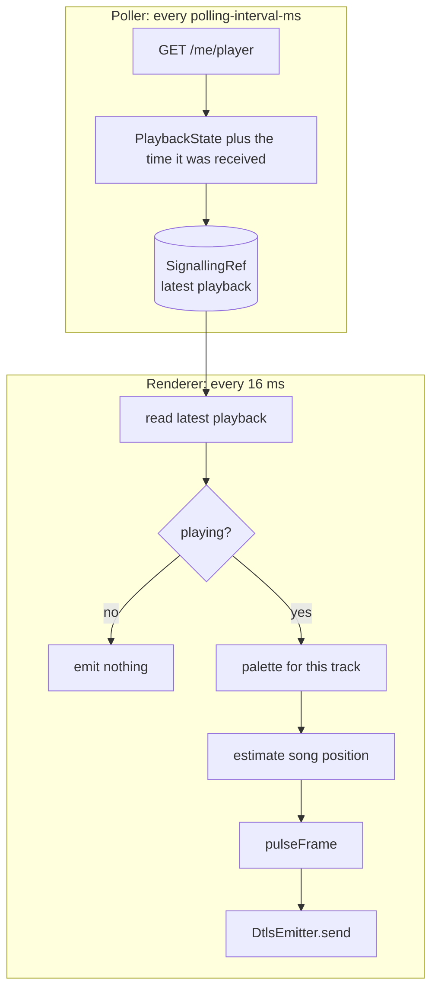

# How it works

This page follows a frame from Spotify to your lights: authentication, the two loops that drive the app, the colour engine, the pulse animation and the Hue streaming protocol.

## 1. Signing in to Spotify

The app uses Spotify's authorization code flow.


- The first call to Spotify triggers the sign-in. The app logs the authorize URL; opening it in a browser completes the flow.
- If `SPOTIFY_SP_DC` is set, the app also requests the authorize URL with that session cookie, which can complete the consent step without a browser.
- The callback server listens only on `127.0.0.1:7070`, so it is not reachable from other machines.

## 2. Two loops: polling and rendering

`SyncEngine.run` merges two fs2 streams that share the latest playback state through a `SignallingRef`.



- **Poller.** Asks Spotify what is playing every `polling-interval-ms` (1000 ms in the shipped config). Failed polls are logged and treated as "nothing playing", so a network blip doesn't stop the app.
- **Renderer.** Runs about 60 times a second. Spotify only reports the song position once per poll, so the renderer estimates where the song is now:

  `position = progress_ms + (now - time the poll arrived) - 150 ms`

  The 150 ms is a manual nudge to line the lights up with the audio.

## 3. The colour engine

### Colours

`RGB` holds three channels, each a refined `Int` between 0 and 255, so an invalid colour can't be constructed through `RGB.safe`. Colour operations convert to HSB (hue, saturation, brightness) where the colour wheel lives, and back to RGB.

### Colour theory

| Relationship | How it's computed | Result |
|---|---|---|
| **Analogous** | Rotate the hue 30° each way on the colour wheel, keeping saturation and brightness | Three neighbouring colours: `[base - 30°, base, base + 30°]` |
| **Complementary** | Invert each RGB channel (`255 - value`) | The colour on the opposite side of the wheel (hue + 180°). Brightness and saturation change too, so a dark colour's complement is light |

Both relationships are checked by property tests: analogous neighbours sit 30° either side of the base hue, and a complement's hue is 180° away.

On the colour wheel, an **analogous** palette is a tight cluster of neighbours, which gives a calm, cohesive look:


A **complementary** palette sits on opposite sides of the wheel, which gives the strongest contrast:


### Palettes

`Palette.random(mode)` picks a random base colour and builds a palette from it:

| `PaletteType` | Colours |
|---|---|
| `Analogous` (used by the engine today) | `[base - 30°, base, base + 30°]` |
| `Complementary` | `[base, complement]` |
| `AnalogousComplementary(Flat)` | the base triad, then the complement's triad |
| `AnalogousComplementary(Interspersed)` | the two triads interleaved, alternating base and complement |
| `Monochromatic`, `Triadic`, `Tetradic` | declared but not implemented yet; they return no palette |

**Analogous-complementary** combines the two: the base triad on one side of the wheel and the complement's triad opposite it. `Order` only changes the sequence, and so which lights get which colour:


A palette is generated the first time a track is seen and cached in a `Ref` for the rest of that track, so the colours stay stable while a song plays.

### Assigning colours to lights

`getColor(index)` is a 1-based circular index: light 1 gets the first colour, and light 0 wraps round to the last. With a three-colour palette `[c1, c2, c3]`, the seven lights get:

| Light | 0 | 1 | 2 | 3 | 4 | 5 | 6 |
|---|---|---|---|---|---|---|---|
| Colour | c3 | c1 | c2 | c3 | c1 | c2 | c3 |


## 4. The pulse

Every light pulses once per beat. The tempo is currently fixed at 20 BPM, so one pulse lasts 3 seconds.

Each beat has three phases:

| Part of the beat | Phase | Brightness curve |
|---|---|---|
| 0% to 20% | attack | rises linearly from 0 to 1 |
| 20% to 30% | sustain | holds at 1 |
| 30% to 100% | decay | falls as `(1 - x)²`, a soft fade that lingers |


The curve value `p` becomes a brightness multiplier of `0.15 + 2.5 × p`:
- at rest, a light glows at 15% of its palette colour
- at the peak, its colour is boosted 2.65×, and channels are capped at 255, so bright colours wash out towards white at the peak

**The wave.** Each light starts its pulse 0.15 of a beat after the one before, so the pulse travels across the zone instead of flashing all lights at once.


Put together, this is what the seven lights show over two beats. You can see the wave travel down the zone, and the colours wash out towards yellow and light pink at each peak, where the 2.65× boost hits the 255 cap:


The pulse is computed by the pure function `SyncEngine.pulseFrame`, which makes it straightforward to test: the tests check the brightness at rest and at the peak, the 0.15-beat delay between lights, and that every value stays between 0 and 255.

## 5. Streaming to Hue

Hue's Entertainment API takes a stream of UDP packets secured with DTLS, instead of one REST call per light change.

1. `HueClient` calls the bridge's CLIP v2 API (`PUT /clip/v2/resource/entertainment_configuration/{zone}`) with `{"action": "start"}`. This opens the streaming port.
2. `DtlsEmitter` opens a DTLS connection to the bridge on port 2100 using Californium Scandium. It authenticates with a pre-shared key: the identity is `HUE_USERNAME` and the key is `HUE_PSK`.
3. Each frame is encoded with scodec into this layout:

| Bytes | Field | Value |
|---|---|---|
| 9 | protocol name | `HueStream` |
| 2 | version | `02 00` |
| 1 | sequence | `00` |
| 2 | reserved | `00 00` |
| 1 | colour space | `00` (RGB) |
| 1 | reserved | `00` |
| 36 | entertainment configuration ID | the zone's UUID as text |
| 7 per light | channel and colour | channel ID (1 byte), then red, green and blue as 16-bit big-endian values |

A frame for seven lights is therefore 52 + 7 × 7 = 101 bytes. The colour engine works in 8-bit colour, so each value is shifted left by 8 bits to fill the 16-bit fields.

4. When the app stops, the stream's finalizer calls `setStreaming(active = false)` and the DTLS connector is closed.

## Known limitations

The [roadmap](roadmap.md) tracks fixes for these.

- **No token refresh.** The access token is never refreshed, and the configured refresh token isn't used yet. When the token expires (Spotify tokens last about an hour), polls come back unauthorised and are treated as "nothing playing", so the lights stop until the app is restarted.
- **Fixed tempo.** Every track pulses at 20 BPM. The client can fetch Spotify's track analysis (and caches it per track), but the engine doesn't use it yet.
- **Fixed zone size.** Frames always address seven light channels.
- **Certificate checks are off.** The Hue bridge serves a self-signed certificate, so the app's HTTP client is built without certificate verification. That client is shared, so Spotify calls skip verification too. A separate client for the bridge would keep verification on for Spotify.

## Regenerating the images

The images on this page are drawn from the app's own code (`Palette.random`, `RGB` and `SyncEngine.pulseFrame`), so they stay accurate when the engine changes. To redraw them:

```sh
sbt "Test/runMain DocImages"
```
