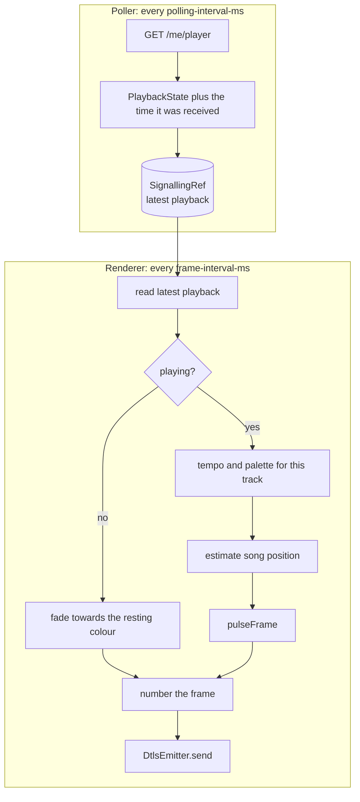
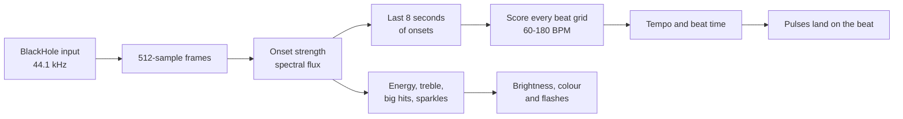

# How it works

This page follows a frame from Spotify to your lights: authentication, the two loops that drive the app, the colour engine, the pulse animation, what happens on pause, and the Hue streaming protocol. Every tuning value mentioned here can be changed in config; see [Configuration](#7-configuration).

## 1. Signing in to Spotify

The app uses Spotify's authorization code flow.


- The first call to Spotify triggers the sign-in. The app logs the authorize URL; opening it in a browser completes the flow.
- If `SPOTIFY_SP_DC` is set, the app also requests the authorize URL with that session cookie, which can complete the consent step without a browser.
- The callback server listens only on `127.0.0.1:7070`, so it is not reachable from other machines.

## 2. Two loops: polling and rendering

`SyncEngine.run` merges two fs2 streams that share the latest playback state through a `SignallingRef`.



- **Poller.** Asks Spotify what is playing every `polling-interval-ms` (1000 ms in the shipped config). Failed polls are logged and treated as "nothing playing", so a network blip doesn't stop the app.
- **Renderer.** Runs every `frame-interval-ms` (16 ms, about 60 times a second). Spotify only reports the song position once per poll, so the renderer estimates where the song is now:

  `position = progress_ms + (now - time the poll arrived) + sync-offset-ms`

  `sync-offset-ms` (−150 ms by default) nudges the lights to line up with the audio.
- The renderer always sends a frame, playing or not, and numbers each one (see [Streaming to Hue](#6-streaming-to-hue)).

## 3. The colour engine

### Colours

`RGB` holds three channels, each a refined `Int` between 0 and 255, so an invalid colour can't be constructed through `RGB.safe`. Colour operations convert to HSB (hue, saturation, brightness), where the colour wheel lives, and back to RGB.

### Colour theory

| Relationship | How it's computed | Result |
|---|---|---|
| **Analogous** | Rotate the hue 30° each way, keeping saturation and brightness | `[base - 30°, base, base + 30°]`: neighbours on the wheel |
| **Complementary** | Invert each RGB channel (`255 - value`) | The colour opposite on the wheel (hue + 180°). Brightness and saturation change too, so a dark colour's complement is light |
| **Triadic** | Rotate the hue by 120° and 240° | Three colours evenly spaced around the wheel |
| **Tetradic** | Rotate the hue by 90°, 180° and 270° | A square: four colours evenly spaced around the wheel |
| **Monochromatic** | Keep the hue and saturation, set brightness to 35%, 65% and 100% | Shades of a single hue |

Each relationship is checked by property tests, for example that triadic hues are 120° apart and that monochromatic shades share one hue.

On the colour wheel, an **analogous** palette is a tight cluster of neighbours, which gives a calm, cohesive look:


A **complementary** palette sits on opposite sides of the wheel, which gives the strongest contrast:


**Triadic** and **tetradic** palettes spread evenly around the wheel, which gives a vivid, varied look:


A **monochromatic** palette stays on one spoke of the wheel and varies only in brightness, which gives a subtle, moody look:


### Palettes

`Palette.random(mode)` picks a random base colour and builds a palette from it. Choose the type with `light-show.palette`:

| `light-show.palette` | `PaletteType` | Colours |
|---|---|---|
| `analogous` (default) | `Analogous` | `[base - 30°, base, base + 30°]` |
| `complementary` | `Complementary` | `[base, complement]` |
| `triadic` | `Triadic` | `[base, base + 120°, base + 240°]` |
| `tetradic` | `Tetradic` | `[base, base + 90°, base + 180°, base + 270°]` |
| `monochromatic` | `Monochromatic` | the base hue at 35%, 65% and 100% brightness |
| `analogous-complementary` | `AnalogousComplementary(Flat)` | the base triad, then the complement's triad |
| `analogous-complementary-interspersed` | `AnalogousComplementary(Interspersed)` | the two triads interleaved |

**Analogous-complementary** combines two of them: the base triad on one side of the wheel and the complement's triad opposite it. `Order` only changes the sequence, and so which lights get which colour:


A palette is generated the first time a track is seen and cached in a `Ref` for the rest of that track, so the colours stay stable while a song plays.

### Assigning colours to lights

At startup the app asks the bridge which channels the entertainment zone has (`GET /clip/v2/resource/entertainment_configuration/{zone}`), so it drives exactly the lights in your zone, sorted by channel ID.

`getColor(index)` is a 0-based circular index: the first light gets the first colour, and the palette repeats after the last one. With a three-colour palette `[c1, c2, c3]` and seven lights:

| Light | 0 | 1 | 2 | 3 | 4 | 5 | 6 |
|---|---|---|---|---|---|---|---|
| Colour | c1 | c2 | c3 | c1 | c2 | c3 | c1 |


## 4. The pulse

### Timing: live beat or Spotify

With `beat-source = "audio"`, the pulses follow the beat detected live from your audio (see [Live beat detection](#live-beat-detection)). While the tracker hasn't locked on, or with `beat-source = "spotify"`, they follow Spotify's playback position at the track's tempo, as described next.

### Tempo from Spotify

When a new track starts, the app asks Spotify for its tempo (`GET /v1/audio-features/{id}`) and pulses in time with it. Spotify restricted this endpoint for newer apps in late 2024; if it refuses, or the request fails, the app uses `default-bpm` (20 BPM, one pulse every 3 seconds) instead. The tempo is fetched once per track and cached.

`beats-per-pulse` slows fast tracks down: `2` pulses on every other beat, so a 128 BPM track pulses at 64 BPM.

### Live beat detection

Spotify's tempo isn't enough to land on the beat: it says how fast, not where the beats fall, and it isn't available to newer apps. So the app can listen to the music itself, through a virtual audio device such as [BlackHole](https://github.com/ExistentialAudio/BlackHole).



1. **Capture.** `AudioInput` reads 16-bit stereo audio from the input named in `audio.device` and mixes it to mono, 512 samples (about 12 ms) at a time.
2. **Onsets.** For each frame, `OnsetDetector` takes a 1024-sample FFT and measures how much louder each frequency got since the last frame (spectral flux). Kicks and note attacks make it spike. Frequencies below about 300 Hz count most, because the kick and bass usually carry the beat while hi-hats fill in between.
3. **Tempo and phase.** Four times a second, `BeatTracker` tries every beat grid between `min-bpm` and `max-bpm` against the last 8 seconds of onsets, and keeps the grid whose beats land on the strongest onsets. Grids that skip beats are penalised, and tempos far from 120 BPM are slightly less likely, which settles most double-or-half ambiguities. The winning grid gives both the tempo and the time of the latest beat.
4. **Pulsing.** Each frame, the engine works out how many beats have passed since that beat, shifted by `audio.offset-ms` to make up for capture and bridge latency, and divides by `beats-per-pulse`.

Each estimate comes with a confidence: how far the grid's beats stand above the average onset, in standard deviations. An estimate below 2.5 is ignored, and the tracker keeps the last confident beat for up to `audio.hold-seconds` (10 seconds), so a breakdown, a quiet bridge or the gap between songs doesn't knock the lights off the beat. After that the show falls back to Spotify timing until the tracker locks on again. The app logs when it locks on and when it loses the beat. If the audio device can't be opened, the app logs why and carries on with Spotify timing.

The tracker is tested against generated drum patterns: it finds the exact tempo between 90 and 150 BPM, finds the tempo or exactly double or half of it between 72 and 170 BPM, and lines its beats up with the real ones to within 30 ms. It also handles a change of tempo and off-beat hi-hats, holds the beat through silence and through a passage with no drums, and lets go once the hold runs out. It runs about 100 times faster than real time.

#### Setting up BlackHole on macOS

1. Install it: `brew install blackhole-2ch` (it asks for your password).
2. Open **Audio MIDI Setup**, click **+**, choose **Create Multi-Output Device**, and tick both your speakers (or headphones) and **BlackHole 2ch**. This lets you hear the music while the app listens to it.
3. Choose that Multi-Output Device as your Mac's sound output.
4. Set `light-show.beat-source = "audio"`. The first time the app listens, macOS may ask for microphone access for your terminal: allow it, or the app only hears silence.

### Shape

Each pulse has three phases, set by `pulse.attack`, `pulse.sustain` and `pulse.decay-curve`:

| Part of the pulse | Phase | Brightness curve |
|---|---|---|
| 0% to 20% | attack | rises linearly from 0 to 1 |
| 20% to 30% | sustain | holds at 1 |
| 30% to 100% | decay | falls as `(1 - x)²`, a soft fade that lingers |


The curve value `p` becomes a brightness multiplier of `rest-level + peak-boost × p`, which is `0.15 + 2.5 × p` by default: a light glows at 15% of its colour's brightness at rest, and is boosted 2.65× at the peak.

### Keeping the colour at the peak

The brightness multiplier is applied in HSB: only the brightness is scaled (and capped at 100%), while the hue and saturation stay the same. The engine used to multiply each RGB channel instead, which capped the strongest channel at 255 while the others kept rising, so bright colours washed out towards yellow and white at every peak:


A property test checks that at the peak the hue never moves by more than 2°.

### The wave

Each light starts its pulse `pulse.stagger` (0.15) of a beat after the one before, so the pulse travels across the zone instead of flashing all lights at once.


Put together, this is what the seven lights show over two beats:


The pulse is computed by the pure functions `Pulse.level`, `Pulse.brightness` and `SyncEngine.pulseFrame`, so it's easy to test: the tests cover the envelope's shape, the stagger, the tempo, the brightness at rest and at the peak, and that every value stays between 0 and 255 for any tuning.

### Reacting to the music

With live beat detection, the lights follow more than the beat. While it listens, the tracker also measures how the music is changing, and `Effects.at` turns that into four reactions, tuned under `reactive`:

| Reaction | What the tracker hears | What the lights do |
|---|---|---|
| Energy | How loud the last second or two is, compared with the usual level over the last 20 seconds or so | Brightness scales with it, between `quietest` (0.35×) and `loudest` (1.6×), so a quiet verse glows and a chorus blazes |
| Treble | How busy the hi-hats and cymbals are, compared with usual | The palette turns by up to `colour-shift` (25°) one way as the treble picks up, and the other way as it drops away |
| Big hits | Loudness jumping above anything in the last 4 seconds by `hit-ratio` (1.15×), such as a crash or a drop | Every light flashes towards white by up to `flash`, fading over about `flash-decay-ms` |
| Sparkles | A treble onset well above the treble background (`sparkle-ratio`), such as a hi-hat | One light, scattered across the zone, twinkles towards white by `sparkle`, fading over about `sparkle-decay-ms` |

The usual level is only learnt while music plays, so a silence between songs doesn't drag it down. Nothing counts as a big hit or a sparkle until a few seconds of music have set the bar. `reactive.enabled = false` turns all four off, and with Spotify timing they don't apply.

The tests use generated drums: energy rises and falls with the loudness and settles at about 1 while the level stays the same; a crash is a big hit at the moment it happens, even on top of a kick, while a steady pattern has none; and hi-hats sparkle while kicks hardly ever do. `Effects.at` and `pulseFrame` are property-tested to keep every value in range for any reading and tuning.

## 5. Pause

When playback stops, or Spotify can't be reached, the lights don't freeze on the last frame. They fade from whatever they were showing to `pause.resting-colour` over `pause.fade-out-ms`, then hold that colour until music starts again. Before anything has played, the zone shows the resting colour.


The fade is a small state machine (`Renderer`): it remembers the last frame that played and when the pause started, and blends each light towards the resting colour. Resuming playback clears the pause, so the next pause fades from the new frame. Because frames keep flowing during a pause, the bridge's stream never goes quiet.

## 6. Streaming to Hue

Hue's Entertainment API takes a stream of UDP packets secured with DTLS, instead of one REST call per light change.

1. `HueClient.getChannels` reads the zone's channel IDs from the bridge.
2. `HueClient.setStreaming` calls the bridge's CLIP v2 API (`PUT /clip/v2/resource/entertainment_configuration/{zone}`) with `{"action": "start"}`. This opens the streaming port.
3. `DtlsEmitter` opens a DTLS connection to the bridge on port 2100 using Californium Scandium. It authenticates with a pre-shared key: the identity is `HUE_USERNAME` and the key is `HUE_PSK`.
4. Each frame is encoded with scodec into this layout:

| Bytes | Field | Value |
|---|---|---|
| 9 | protocol name | `HueStream` |
| 2 | version | `02 00` |
| 1 | sequence | counts up with every frame, wrapping from 255 back to 0 |
| 2 | reserved | `00 00` |
| 1 | colour space | `00` (RGB) |
| 1 | reserved | `00` |
| 36 | entertainment configuration ID | the zone's UUID as text |
| 7 per light | channel and colour | channel ID (1 byte), then red, green and blue as 16-bit big-endian values |

A frame is 52 bytes plus 7 per channel, so 101 bytes for seven lights. The colour engine works in 8-bit colour, so each value is shifted left by 8 bits to fill the 16-bit fields.

5. When the app stops, the stream's finalizer calls `setStreaming(active = false)` and the DTLS connector is closed.

## 7. Configuration

All light-show settings live under `light-show` in `src/main/resources/reference.conf`, with a description of each. Override any of them in `application.conf`:

```hocon
light-show {
  palette = "triadic"
  beats-per-pulse = 2
  pulse.peak-boost = 1.5
  pause.resting-colour = "#0a0a20"
}
```

| Setting | Default | What it does |
|---|---|---|
| `palette` | `analogous` | Palette type (see [Palettes](#palettes)) |
| `beat-source` | `spotify` | `audio` to follow the live beat, `spotify` to follow playback position and tempo |
| `audio.device` | `BlackHole` | Audio input to listen to, matched by name |
| `audio.offset-ms` | `100` | Shifts the lights relative to the detected beat; positive is earlier |
| `audio.min-bpm`, `audio.max-bpm` | `60`, `180` | Tempo range the beat tracker searches |
| `audio.hold-seconds` | `10` | How long to keep the last confident beat when the music no longer gives a clear one |
| `reactive.enabled` | `true` | Turns the [reactions to the music](#reacting-to-the-music) on or off |
| `reactive.quietest`, `reactive.loudest` | `0.35`, `1.6` | Brightness range as the energy changes |
| `reactive.colour-shift` | `25` | Degrees the palette turns with the treble |
| `reactive.flash`, `reactive.flash-decay-ms` | `0.7`, `200` | How far a big hit flashes towards white, and how fast it fades |
| `reactive.hit-ratio` | `1.15` | How much louder than the last few seconds counts as a big hit |
| `reactive.sparkle`, `reactive.sparkle-decay-ms` | `0.6`, `100` | How far a sparkle twinkles towards white, and how fast it fades |
| `reactive.sparkle-ratio` | `4.0` | How far above the treble background counts as a sparkle |
| `default-bpm` | `20` | Tempo used when Spotify can't provide one |
| `beats-per-pulse` | `1` | Pulse once every N beats |
| `sync-offset-ms` | `-150` | Shifts the lights relative to the audio |
| `frame-interval-ms` | `16` | Time between frames |
| `pulse.stagger` | `0.15` | Delay between neighbouring lights, in beats |
| `pulse.attack` | `0.2` | Fraction of a pulse spent rising |
| `pulse.sustain` | `0.1` | Fraction of a pulse held at full brightness |
| `pulse.decay-curve` | `2.0` | Shape of the fade; higher fades faster |
| `pulse.rest-level` | `0.15` | Brightness multiplier at rest |
| `pulse.peak-boost` | `2.5` | Brightness added at the peak |
| `pause.resting-colour` | `#1e1408` | Colour shown while nothing plays |
| `pause.fade-out-ms` | `2000` | How long the fade to the resting colour takes |

The config is validated when the app starts: an unknown palette name, an invalid colour, or tuning that can't work (for example `attack + sustain` of 1 or more) stops the app with a message saying what's wrong.

## Known limitations

The [roadmap](roadmap.md) tracks fixes for these.

- **No token refresh.** The access token is never refreshed, and the configured refresh token isn't used yet. When the token expires (Spotify tokens last about an hour), polls come back unauthorised and are treated as "nothing playing", so the lights fade to rest until the app is restarted.
- **Spotify timing isn't aligned to the beat.** Without live beat detection, pulses are counted from the start of the track at Spotify's tempo (or the default), so they can be offset from the actual beats. Use `beat-source = "audio"` for real beat sync.
- **The beat tracker can count double or half time** on very slow or very fast music, which is a common ambiguity. `audio.min-bpm` and `audio.max-bpm` narrow the range.
- **Sustained notes on their own can read as a beat.** A held chord with no drums can ripple steadily enough for the tracker to find a tempo in it: a generated chord does this after a few seconds on its own. The hold keeps short breakdowns on the old beat, but a long ambient intro may pulse at a tempo that isn't there until the drums come in.
- **Certificate checks are off.** The Hue bridge serves a self-signed certificate, so the app's HTTP client is built without certificate verification. That client is shared, so Spotify calls skip verification too. A separate client for the bridge would keep verification on for Spotify.

## Regenerating the images

The images on this page are drawn from the app's own code (`Palette.random`, `RGB`, `Pulse`, `Renderer` and `SyncEngine.pulseFrame`), so they stay accurate when the engine changes. The comparison in [Keeping the colour at the peak](#keeping-the-colour-at-the-peak) also redraws the old RGB multiplication, for reference. To redraw them:

```sh
sbt "Test/runMain DocImages"
```
